# Documentación de Modelos - Pw3c Distribuidora

> **Framework:** Laravel 9 (Eloquent ORM)
> **Total de modelos:** 47 (56 tablas en BD, incluyendo 3 de Laravel + 1 dropeada + 5 pivotes)

---

## Índice

1. [Seguridad](#1-seguridad)
   - [Usuario](#usuario)
   - [EstadoUsuario](#estadousuario)
   - [Rol](#rol)
   - [Permiso](#permiso)
   - [Modulo](#modulo)
   - [Accion](#accion)
   - [TablaSistema](#tablasistema)
   - [Auditoria](#auditoria)
   - [SesionUsuario](#sesionusuario)
2. [Farmacia](#2-farmacia)
   - [Farmacia](#farmacia)
   - [ContactoFarmacia](#contactofarmacia)
   - [Cargo](#cargo)
3. [Repartidor](#3-repartidor)
   - [Repartidor](#repartidor)
   - [EstadoRepartidor](#estadorepartidor)
   - [HistorialEstadoRepartidor](#historialestadorepartidor)
   - [Licencia](#licencia)
   - [ExtensionCI](#extensionci)
4. [Vehículo](#4-vehículo)
   - [Vehiculo](#vehiculo)
   - [EstadoVehiculo](#estadovehiculo)
   - [HistorialEstadoVehiculo](#historialestadovehiculo)
   - [Marca](#marca)
   - [Modelo](#modelo)
   - [Capacidad](#capacidad)
5. [Pedido](#5-pedido)
   - [Pedido](#pedido)
   - [EstadoPedido](#estadopedido)
   - [HistorialEstadoPedido](#historialestadopedido)
   - [DetallePedido](#detallepedido)
   - [Producto](#producto)
   - [EstadoDetalle](#estadodetalle)
6. [Despacho](#6-despacho)
   - [Despacho](#despacho)
   - [EstadoDespacho](#estadodespacho)
   - [HistorialEstadoDespacho](#historialestadodespacho)
7. [Logística](#7-logística)
   - [Ruta](#ruta)
   - [RutaParada](#rutaparada)
   - [ControlRuta](#controlruta)
   - [EstadoRuta](#estadoruta)
   - [HistorialEstadoRuta](#historialestadoruta)
   - [PlanificacionRuta](#planificacionruta)
   - [ControlRutaParada](#controlrutaparada)
   - [AsignacionVehiculoRepartidor](#asignacionvehiculorepartidor)
8. [Evidencia](#8-evidencia)
   - [EvidenciaEntrega](#evidenciaentrega)
   - [Incidencia](#incidencia)
   - [TipoEvidencia](#tipoevidencia)
   - [TipoIncidencia](#tipoincidencia)
9. [Caja](#9-caja)
   - [CajaRepartidor](#cajarepartidor)
   - [GastoOperativo](#gastooperativo)
   - [EstadoCaja](#estadocaja)
10. [Modelos Huérfanos](#10-modelos-huérfanos)
11. [Leyenda](#11-leyenda)

---

## Diagrama ERD General (Mermaid)

```mermaid
erDiagram
    usuarios {
        bigint id_usuario PK
        string nombre
        string apellido
        string email UK
        string password_hash
        string telefono
        tinyint id_estado_usuario FK
        timestamp fecha_creacion
        timestamp fecha_bloqueo "nullable"
        timestamp ultimo_acceso "nullable"
        string remember_token "nullable"
    }
    estados_usuario {
        tinyint id_estado_usuario PK
        string nombre_estado UK
    }
    roles {
        tinyint id_rol PK
        string nombre UK
    }
    modulos {
        tinyint id_modulo PK
        string nombre UK
    }
    acciones {
        tinyint id_accion PK
        string nombre UK
    }
    permisos {
        bigint id_permiso PK
        tinyint id_modulo FK
        tinyint id_accion FK
    }
    tablas_sistema {
        tinyint id_tabla PK
        string nombre UK
    }
    usuario_roles {
        bigint id_usuario_rol PK
        bigint id_usuario FK
        tinyint id_rol FK
    }
    rol_permiso {
        bigint id_rol_permiso PK
        tinyint id_rol FK
        bigint id_permiso FK
    }
    auditorias {
        bigint id_auditoria PK
        bigint id_usuario FK
        tinyint id_accion FK
        tinyint id_tabla FK
        bigint registro_id
        timestamp fecha_hora
    }
    sesiones_usuario {
        bigint id_sesion PK
        bigint id_usuario FK
        timestamp fecha_inicio
        timestamp fecha_fin "nullable"
    }
    farmacias {
        bigint id_farmacia PK
        string nombre
        text direccion
        string telefono
        string email "nullable, UK"
        decimal latitud "nullable"
        decimal longitud "nullable"
        timestamp created_at
        timestamp updated_at
    }
    cargos {
        tinyint id_cargo PK
        string nombre_cargo UK
    }
    contactos_farmacia {
        bigint id_contacto PK
        bigint id_farmacia FK
        string nombre_contacto
        tinyint id_cargo FK
        string telefono
        string email "nullable"
    }
    repartidores {
        bigint id_repartidor PK
        bigint id_usuario FK, UK
        string ci UK
        tinyint id_extension_ci FK
        tinyint id_licencia FK
        tinyint id_estado_repartidor FK
        string firebase_uid "nullable, UK"
    }
    estados_repartidor {
        tinyint id_estado_repartidor PK
        string nombre_estado UK
    }
    historial_estado_repartidor {
        bigint id_historial PK
        bigint id_repartidor FK
        tinyint id_estado_repartidor FK
        timestamp fecha_inicio
        timestamp fecha_fin "nullable"
    }
    licencias {
        tinyint id_licencia PK
        string categoria UK
    }
    extensiones_ci {
        tinyint id_extension_ci PK
        string nombre_extension UK
    }
    vehiculos {
        bigint id_vehiculo PK
        string placa UK
        smallint id_modelo FK
        tinyint id_capacidad FK
        tinyint id_estado_vehiculo FK
    }
    estados_vehiculo {
        tinyint id_estado_vehiculo PK
        string nombre_estado UK
    }
    historial_estado_vehiculo {
        bigint id_historial PK
        bigint id_vehiculo FK
        tinyint id_estado_vehiculo FK
        timestamp fecha_inicio
        timestamp fecha_fin "nullable"
    }
    marcas {
        tinyint id_marca PK
        string nombre_marca UK
    }
    modelos {
        smallint id_modelo PK
        tinyint id_marca FK
        string nombre_modelo
    }
    capacidades {
        tinyint id_capacidad PK
        decimal capacidad_kg UK
    }
    pedidos {
        bigint id_pedido PK
        bigint id_farmacia FK
        bigint id_usuario FK
        tinyint id_estado_pedido FK
        timestamp fecha_pedido
        text observaciones "nullable"
        decimal subtotal
        decimal descuento
        decimal total
        string archivo_pedido "nullable"
    }
    estados_pedido {
        tinyint id_estado_pedido PK
        string nombre_estado UK
    }
    historial_estado_pedido {
        bigint id_historial PK
        bigint id_pedido FK
        tinyint id_estado_pedido FK
        timestamp fecha_inicio
        timestamp fecha_fin "nullable"
    }
    productos {
        bigint id_producto PK
        string nombre
        decimal precio_unitario
        string unidad_medida
        boolean estado
        timestamp created_at
        timestamp updated_at
    }
    estados_detalle {
        tinyint id_estado_detalle PK
        string nombre_estado UK
    }
    detalle_pedido {
        bigint id_detalle PK
        bigint id_pedido FK
        bigint id_producto FK
        decimal cantidad_solicitada
        decimal cantidad_entregada
        decimal precio_unitario
        decimal subtotal
        tinyint id_estado_detalle FK
    }
    despachos {
        bigint id_despacho PK
        bigint id_pedido FK, UK
        bigint id_parada FK
        bigint id_control_ruta FK
        timestamp fecha_hora_despacho
        tinyint id_estado_despacho FK
    }
    estados_despacho {
        tinyint id_estado_despacho PK
        string nombre_estado UK
    }
    historial_estado_despacho {
        bigint id_historial PK
        bigint id_despacho FK
        tinyint id_estado_despacho FK
        timestamp fecha_inicio
        timestamp fecha_fin "nullable"
    }
    evidencias_entrega {
        bigint id_evidencia PK
        bigint id_despacho FK
        tinyint id_tipo_evidencia FK
        string archivo
        timestamp fecha_registro
    }
    tipos_evidencia {
        tinyint id_tipo_evidencia PK
        string nombre_tipo UK
    }
    incidencias {
        bigint id_incidencia PK
        bigint id_despacho FK
        tinyint id_tipo_incidencia FK
        text descripcion
        timestamp fecha_incidencia
    }
    tipos_incidencia {
        tinyint id_tipo_incidencia PK
        string nombre_tipo UK
    }
    rutas {
        smallint id_ruta PK
        string nombre_ruta UK
    }
    ruta_paradas {
        bigint id_parada PK
        smallint id_ruta FK
        bigint id_farmacia FK
        smallint orden_parada
        time hora_estimada
    }
    control_rutas {
        bigint id_control_ruta PK
        smallint id_ruta FK
        date fecha_ruta
        time hora_salida
        time hora_llegada_real "nullable"
        bigint id_repartidor FK
        bigint id_vehiculo FK
        tinyint id_estado_ruta FK
    }
    estados_ruta {
        tinyint id_estado_ruta PK
        string nombre_estado UK
    }
    historial_estado_ruta {
        bigint id_historial PK
        bigint id_control_ruta FK
        tinyint id_estado_ruta FK
        datetime fecha_inicio
        datetime fecha_fin "nullable"
    }
    planificacion_rutas {
        bigint id_planificacion PK
        bigint id_usuario FK
        bigint id_control_ruta FK "nullable"
        string estado
        json datos_json "nullable"
        datetime fecha_creacion
        datetime fecha_confirmacion "nullable"
    }
    control_ruta_paradas {
        bigint id_control_ruta_parada PK
        bigint id_control_ruta FK
        bigint id_pedido FK "nullable"
        bigint id_farmacia FK
        integer orden_parada
        time hora_estimada "nullable"
        time hora_llegada_real "nullable"
        timestamp created_at
        timestamp updated_at
    }
    asignaciones_vehiculo_repartidor {
        bigint id_asignacion PK
        bigint id_repartidor FK
        bigint id_vehiculo FK
        datetime fecha_inicio
        datetime fecha_fin "nullable"
        boolean activo
        string observaciones "nullable"
        timestamp created_at
        timestamp updated_at
    }
    caja_repartidor {
        bigint id_caja PK
        bigint id_control_ruta FK "nullable, UK"
        bigint id_repartidor FK
        date fecha
        decimal monto_inicial
        decimal ingresos
        decimal gastos
        decimal monto_final
        tinyint id_estado_caja FK
    }
    estados_caja {
        tinyint id_estado_caja PK
        string nombre_estado UK
    }
    gastos_operativos {
        bigint id_gasto PK
        bigint id_caja FK
        string tipo_gasto
        string descripcion "nullable"
        decimal monto
        string comprobante "nullable"
        datetime fecha
    }
```

### Relaciones Principales

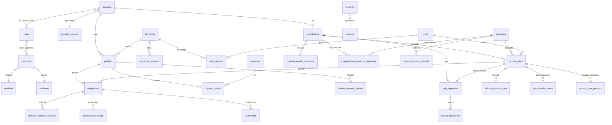

---

## 1. Seguridad

### Diagrama ERD - Seguridad

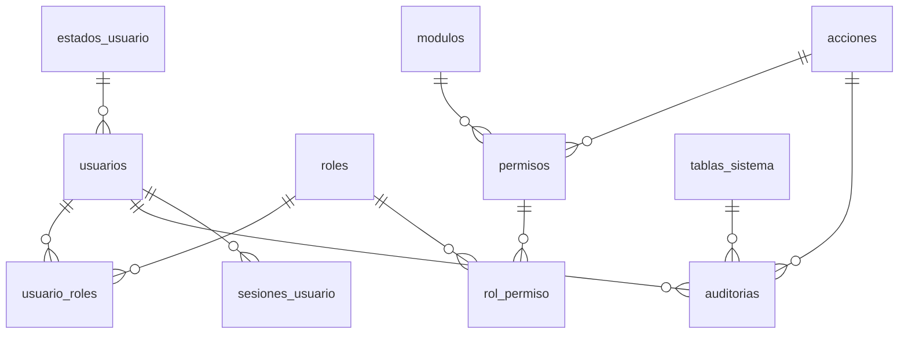

---

### Usuario

| Campo | Tipo | Descripción |
|-------|------|-------------|
| `id_usuario` | PK (bigIncrements) | Identificador único |
| `nombre` | string(100) | Nombre del usuario |
| `apellido` | string(100) | Apellido del usuario |
| `email` | string(180) | Correo electrónico (**unique**) |
| `password_hash` | string(255) | Contraseña hasheada (hidden) |
| `telefono` | string(20) | Teléfono |
| `id_estado_usuario` | FK→`estados_usuario` | Estado del usuario (restrict) |
| `fecha_creacion` | timestamp | Fecha de creación (useCurrent) |
| `fecha_bloqueo` | timestamp | Fecha de bloqueo (nullable) |
| `ultimo_acceso` | timestamp | Último acceso (nullable) |
| `remember_token` | string(100) | Token remember me (nullable, hidden) |

**Tabla:** `usuarios` | **PK:** `id_usuario` | **Timestamps:** No | **Traits:** HasApiTokens, HasFactory, Notifiable

**Extiende:** `Illuminate\Foundation\Auth\User` (Authenticatable)

**Hidden:** `password_hash`, `remember_token`

**Casts:** `fecha_creacion:datetime`, `fecha_bloqueo:datetime`, `ultimo_acceso:datetime`

**Métodos destacados:**
- `getAuthPassword(): string` — Retorna `password_hash` en lugar del campo `password` convencional de Laravel
- `hasPermission(string $modulo, string $accion): bool` — Itera roles y permisos para verificar acceso

**Relaciones:**
| Tipo | Método | Modelo destino | FK |
|------|--------|----------------|----|
| belongsTo | `estado()` | `EstadoUsuario` | `id_estado_usuario` |
| belongsToMany | `roles()` | `Rol` | pivot: `usuario_roles` (id_usuario, id_rol) |
| hasMany | `pedidos()` | `Pedido` | `id_usuario` |
| hasOne | `repartidor()` | `Repartidor` | `id_usuario` |
| hasMany | `sesiones()` | `SesionUsuario` | `id_usuario` |
| hasMany | `auditorias()` | `Auditoria` | `id_usuario` |

---

### EstadoUsuario

| Campo | Tipo | Descripción |
|-------|------|-------------|
| `id_estado_usuario` | PK (tinyIncrements) | Identificador único |
| `nombre_estado` | string(50) | Nombre del estado (**unique**) |

**Tabla:** `estados_usuario` | **PK:** `id_estado_usuario` | **Timestamps:** No

**Relaciones:**
| Tipo | Método | Modelo destino | FK |
|------|--------|----------------|----|
| hasMany | `usuarios()` | `Usuario` | `id_estado_usuario` |

---

### Rol

| Campo | Tipo | Descripción |
|-------|------|-------------|
| `id_rol` | PK (tinyIncrements) | Identificador único |
| `nombre` | string(50) | Nombre del rol (**unique**) |

**Tabla:** `roles` | **PK:** `id_rol` | **Timestamps:** No

**Relaciones:**
| Tipo | Método | Modelo destino | FK |
|------|--------|----------------|----|
| belongsToMany | `usuarios()` | `Usuario` | pivot: `usuario_roles` |
| belongsToMany | `permisos()` | `Permiso` | pivot: `rol_permiso` |

---

### Permiso

| Campo | Tipo | Descripción |
|-------|------|-------------|
| `id_permiso` | PK (bigIncrements) | Identificador único |
| `id_modulo` | FK→`modulos` | Módulo asociado (restrict) |
| `id_accion` | FK→`acciones` | Acción asociada (restrict) |

**Tabla:** `permisos` | **PK:** `id_permiso` | **Timestamps:** No

**Unique compuesto:** `(id_modulo, id_accion)`

**Relaciones:**
| Tipo | Método | Modelo destino | FK |
|------|--------|----------------|----|
| belongsTo | `modulo()` | `Modulo` | `id_modulo` |
| belongsTo | `accion()` | `Accion` | `id_accion` |
| belongsToMany | `roles()` | `Rol` | pivot: `rol_permiso` |

---

### Modulo

| Campo | Tipo | Descripción |
|-------|------|-------------|
| `id_modulo` | PK (tinyIncrements) | Identificador único |
| `nombre` | string(50) | Nombre del módulo (**unique**) |

**Tabla:** `modulos` | **PK:** `id_modulo` | **Timestamps:** No

**Relaciones:**
| Tipo | Método | Modelo destino | FK |
|------|--------|----------------|----|
| hasMany | `permisos()` | `Permiso` | `id_modulo` |

---

### Accion

| Campo | Tipo | Descripción |
|-------|------|-------------|
| `id_accion` | PK (tinyIncrements) | Identificador único |
| `nombre` | string(50) | Nombre de la acción (**unique**) |

**Tabla:** `acciones` | **PK:** `id_accion` | **Timestamps:** No

**Relaciones:**
| Tipo | Método | Modelo destino | FK |
|------|--------|----------------|----|
| hasMany | `permisos()` | `Permiso` | `id_accion` |

---

### TablaSistema

| Campo | Tipo | Descripción |
|-------|------|-------------|
| `id_tabla` | PK (tinyIncrements) | Identificador único |
| `nombre` | string(100) | Nombre de la tabla del sistema auditada (**unique**) |

**Tabla:** `tablas_sistema` | **PK:** `id_tabla` | **Timestamps:** No

**Relaciones:**
| Tipo | Método | Modelo destino | FK |
|------|--------|----------------|----|
| hasMany | `auditorias()` | `Auditoria` | `id_tabla` |

---

### Auditoria

| Campo | Tipo | Descripción |
|-------|------|-------------|
| `id_auditoria` | PK (bigIncrements) | Identificador único |
| `id_usuario` | FK→`usuarios` | Usuario que realizó la acción (restrict) |
| `id_accion` | FK→`acciones` | Acción realizada (restrict) |
| `id_tabla` | FK→`tablas_sistema` | Tabla afectada (restrict) |
| `registro_id` | unsignedBigInteger | ID del registro afectado |
| `fecha_hora` | timestamp | Fecha y hora de la auditoría (useCurrent) |

**Tabla:** `auditorias` | **PK:** `id_auditoria` | **Timestamps:** No

**Casts:** `fecha_hora:datetime`

**Relaciones:**
| Tipo | Método | Modelo destino | FK |
|------|--------|----------------|----|
| belongsTo | `usuario()` | `Usuario` | `id_usuario` |
| belongsTo | `accion()` | `Accion` | `id_accion` |
| belongsTo | `tabla()` | `TablaSistema` | `id_tabla` |

---

### SesionUsuario

| Campo | Tipo | Descripción |
|-------|------|-------------|
| `id_sesion` | PK (bigIncrements) | Identificador único |
| `id_usuario` | FK→`usuarios` | Usuario de la sesión (cascade) |
| `fecha_inicio` | timestamp | Inicio de sesión (useCurrent) |
| `fecha_fin` | timestamp | Fin de sesión (nullable) |

**Tabla:** `sesiones_usuario` | **PK:** `id_sesion` | **Timestamps:** No

**Casts:** `fecha_inicio:datetime`, `fecha_fin:datetime`

**Relaciones:**
| Tipo | Método | Modelo destino | FK |
|------|--------|----------------|----|
| belongsTo | `usuario()` | `Usuario` | `id_usuario` |

---

## 2. Farmacia

### Diagrama ERD - Farmacia

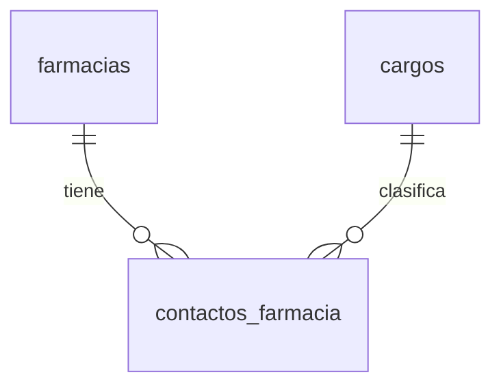

---

### Farmacia

| Campo | Tipo | Descripción |
|-------|------|-------------|
| `id_farmacia` | PK (bigIncrements) | Identificador único |
| `nombre` | string(150) | Nombre de la farmacia |
| `direccion` | text | Dirección |
| `telefono` | string(20) | Teléfono |
| `email` | string(180) | Correo electrónico (**unique**, nullable) |
| `latitud` | decimal(10,7) | Latitud de ubicación (**nullable**) |
| `longitud` | decimal(10,7) | Longitud de ubicación (**nullable**) |

**Tabla:** `farmacias` | **PK:** `id_farmacia` | **Timestamps:** Sí (created_at, updated_at) | **Traits:** HasFactory

> Las coordenadas `latitud`/`longitud` fueron hechas nullable por migración `2024_06_11_000018`.

**Relaciones:**
| Tipo | Método | Modelo destino | FK |
|------|--------|----------------|----|
| hasMany | `contactos()` | `ContactoFarmacia` | `id_farmacia` |
| hasMany | `pedidos()` | `Pedido` | `id_farmacia` |
| hasMany | `paradas()` | `RutaParada` | `id_farmacia` |

---

### ContactoFarmacia

| Campo | Tipo | Descripción |
|-------|------|-------------|
| `id_contacto` | PK (bigIncrements) | Identificador único |
| `id_farmacia` | FK→`farmacias` | Farmacia asociada (cascade) |
| `nombre_contacto` | string(150) | Nombre del contacto |
| `id_cargo` | FK→`cargos` | Cargo del contacto (restrict) |
| `telefono` | string(20) | Teléfono del contacto |
| `email` | string(180) | Correo electrónico (nullable) |

**Tabla:** `contactos_farmacia` | **PK:** `id_contacto` | **Timestamps:** No | **Traits:** HasFactory

**Relaciones:**
| Tipo | Método | Modelo destino | FK |
|------|--------|----------------|----|
| belongsTo | `farmacia()` | `Farmacia` | `id_farmacia` |
| belongsTo | `cargo()` | `Cargo` | `id_cargo` |

---

### Cargo

| Campo | Tipo | Descripción |
|-------|------|-------------|
| `id_cargo` | PK (tinyIncrements) | Identificador único |
| `nombre_cargo` | string(100) | Nombre del cargo (**unique**) |

**Tabla:** `cargos` | **PK:** `id_cargo` | **Timestamps:** No

**Relaciones:**
| Tipo | Método | Modelo destino | FK |
|------|--------|----------------|----|
| hasMany | `contactos()` | `ContactoFarmacia` | `id_cargo` |

---

## 3. Repartidor

### Diagrama ERD - Repartidor

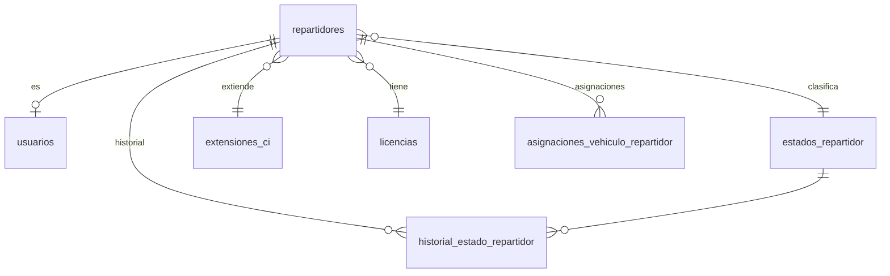

---

### Repartidor

| Campo | Tipo | Descripción |
|-------|------|-------------|
| `id_repartidor` | PK (bigIncrements) | Identificador único |
| `id_usuario` | FK→`usuarios` | Usuario asociado (**unique**, cascade) |
| `ci` | string(20) | Cédula de identidad (**unique**) |
| `id_extension_ci` | FK→`extensiones_ci` | Extensión del CI (restrict) |
| `id_licencia` | FK→`licencias` | Categoría de licencia (restrict) |
| `id_estado_repartidor` | FK→`estados_repartidor` | Estado del repartidor (restrict) |
| `firebase_uid` | string(191) | UID de Firebase (**unique**, nullable) |

**Tabla:** `repartidores` | **PK:** `id_repartidor` | **Timestamps:** No | **Traits:** HasFactory

> `firebase_uid` y unique en `id_usuario` agregados por migración `2024_06_11_000014`.

**Relaciones:**
| Tipo | Método | Modelo destino | FK |
|------|--------|----------------|----|
| belongsTo | `usuario()` | `Usuario` | `id_usuario` |
| belongsTo | `extensionCi()` | `ExtensionCI` | `id_extension_ci` |
| belongsTo | `licencia()` | `Licencia` | `id_licencia` |
| belongsTo | `estado()` | `EstadoRepartidor` | `id_estado_repartidor` |
| hasMany | `historiales()` | `HistorialEstadoRepartidor` | `id_repartidor` |
| hasMany | `controlRutas()` | `ControlRuta` | `id_repartidor` |
| hasMany | `asignacionesVehiculo()` | `AsignacionVehiculoRepartidor` | `id_repartidor` |
| hasOne | `asignacionVehiculoActiva()` | `AsignacionVehiculoRepartidor` | `id_repartidor` (where activo=1, fecha_fin null) |
| hasOneThrough | `vehiculoActual()` | `Vehiculo` (vía `AsignacionVehiculoRepartidor`) | `id_repartidor` → `id_vehiculo` (filtro activo) |
| hasOneThrough | `ultimoVehiculoUsado()` | `Vehiculo` (vía `ControlRuta`) | `id_repartidor` → `id_vehiculo` (latest) |

---

### EstadoRepartidor

| Campo | Tipo | Descripción |
|-------|------|-------------|
| `id_estado_repartidor` | PK (tinyIncrements) | Identificador único |
| `nombre_estado` | string(50) | Nombre del estado (**unique**) |

**Tabla:** `estados_repartidor` | **PK:** `id_estado_repartidor` | **Timestamps:** No

**Relaciones:**
| Tipo | Método | Modelo destino | FK |
|------|--------|----------------|----|
| hasMany | `repartidores()` | `Repartidor` | `id_estado_repartidor` |
| hasMany | `historiales()` | `HistorialEstadoRepartidor` | `id_estado_repartidor` |

---

### HistorialEstadoRepartidor

| Campo | Tipo | Descripción |
|-------|------|-------------|
| `id_historial` | PK (bigIncrements) | Identificador único |
| `id_repartidor` | FK→`repartidores` | Repartidor asociado (cascade) |
| `id_estado_repartidor` | FK→`estados_repartidor` | Estado asignado (restrict) |
| `fecha_inicio` | timestamp | Fecha de inicio del estado (useCurrent) |
| `fecha_fin` | timestamp | Fecha de fin del estado (nullable) |

**Tabla:** `historial_estado_repartidor` | **PK:** `id_historial` | **Timestamps:** No

**Casts:** `fecha_inicio:datetime`, `fecha_fin:datetime`

**Unique compuesto:** `(id_repartidor, fecha_inicio)`

**Relaciones:**
| Tipo | Método | Modelo destino | FK |
|------|--------|----------------|----|
| belongsTo | `repartidor()` | `Repartidor` | `id_repartidor` |
| belongsTo | `estado()` | `EstadoRepartidor` | `id_estado_repartidor` |

---

### Licencia

| Campo | Tipo | Descripción |
|-------|------|-------------|
| `id_licencia` | PK (tinyIncrements) | Identificador único |
| `categoria` | string(20) | Categoría de licencia (**unique**) |

**Tabla:** `licencias` | **PK:** `id_licencia` | **Timestamps:** No

**Relaciones:**
| Tipo | Método | Modelo destino | FK |
|------|--------|----------------|----|
| hasMany | `repartidores()` | `Repartidor` | `id_licencia` |

---

### ExtensionCI

| Campo | Tipo | Descripción |
|-------|------|-------------|
| `id_extension_ci` | PK (tinyIncrements) | Identificador único |
| `nombre_extension` | string(10) | Extensión del CI (**unique**) |

**Tabla:** `extensiones_ci` | **PK:** `id_extension_ci` | **Timestamps:** No

**Relaciones:**
| Tipo | Método | Modelo destino | FK |
|------|--------|----------------|----|
| hasMany | `repartidores()` | `Repartidor` | `id_extension_ci` |

---

## 4. Vehículo

### Diagrama ERD - Vehículo

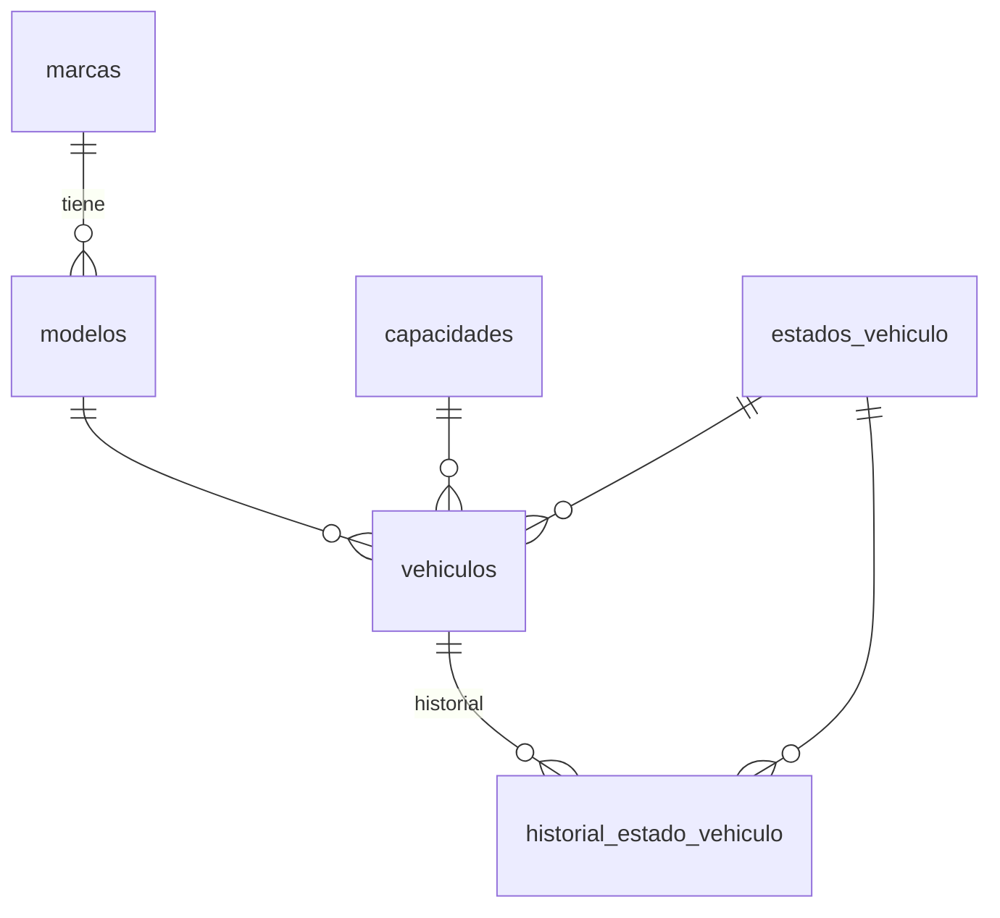

---

### Vehiculo

| Campo | Tipo | Descripción |
|-------|------|-------------|
| `id_vehiculo` | PK (bigIncrements) | Identificador único |
| `placa` | string(20) | Placa del vehículo (**unique**) |
| `id_modelo` | FK→`modelos` | Modelo del vehículo (**restrict**) |
| `id_capacidad` | FK→`capacidades` | Capacidad de carga (restrict) |
| `id_estado_vehiculo` | FK→`estados_vehiculo` | Estado del vehículo (restrict) |

**Tabla:** `vehiculos` | **PK:** `id_vehiculo` | **Timestamps:** No | **Traits:** HasFactory

**Relaciones:**
| Tipo | Método | Modelo destino | FK |
|------|--------|----------------|----|
| belongsTo | `modelo()` | `Modelo` | `id_modelo` |
| belongsTo | `capacidad()` | `Capacidad` | `id_capacidad` |
| belongsTo | `estado()` | `EstadoVehiculo` | `id_estado_vehiculo` |
| hasMany | `historiales()` | `HistorialEstadoVehiculo` | `id_vehiculo` |
| hasMany | `controlRutas()` | `ControlRuta` | `id_vehiculo` |
| hasMany | `asignacionesRepartidor()` | `AsignacionVehiculoRepartidor` | `id_vehiculo` |
| hasOne | `asignacionActiva()` | `AsignacionVehiculoRepartidor` | `id_vehiculo` (where activo=1, fecha_fin null) |

---

### EstadoVehiculo

| Campo | Tipo | Descripción |
|-------|------|-------------|
| `id_estado_vehiculo` | PK (tinyIncrements) | Identificador único |
| `nombre_estado` | string(50) | Nombre del estado (**unique**) |

**Tabla:** `estados_vehiculo` | **PK:** `id_estado_vehiculo` | **Timestamps:** No

**Relaciones:**
| Tipo | Método | Modelo destino | FK |
|------|--------|----------------|----|
| hasMany | `vehiculos()` | `Vehiculo` | `id_estado_vehiculo` |
| hasMany | `historiales()` | `HistorialEstadoVehiculo` | `id_estado_vehiculo` |

---

### HistorialEstadoVehiculo

| Campo | Tipo | Descripción |
|-------|------|-------------|
| `id_historial` | PK (bigIncrements) | Identificador único |
| `id_vehiculo` | FK→`vehiculos` | Vehículo asociado (cascade) |
| `id_estado_vehiculo` | FK→`estados_vehiculo` | Estado asignado (restrict) |
| `fecha_inicio` | timestamp | Fecha de inicio del estado (useCurrent) |
| `fecha_fin` | timestamp | Fecha de fin del estado (nullable) |

**Tabla:** `historial_estado_vehiculo` | **PK:** `id_historial` | **Timestamps:** No

**Casts:** `fecha_inicio:datetime`, `fecha_fin:datetime`

**Unique compuesto:** `(id_vehiculo, fecha_inicio)`

**Relaciones:**
| Tipo | Método | Modelo destino | FK |
|------|--------|----------------|----|
| belongsTo | `vehiculo()` | `Vehiculo` | `id_vehiculo` |
| belongsTo | `estado()` | `EstadoVehiculo` | `id_estado_vehiculo` |

---

### Marca

| Campo | Tipo | Descripción |
|-------|------|-------------|
| `id_marca` | PK (tinyIncrements) | Identificador único |
| `nombre_marca` | string(50) | Nombre de la marca (**unique**) |

**Tabla:** `marcas` | **PK:** `id_marca` | **Timestamps:** No

**Relaciones:**
| Tipo | Método | Modelo destino | FK |
|------|--------|----------------|----|
| hasMany | `modelos()` | `Modelo` | `id_marca` |

---

### Modelo

| Campo | Tipo | Descripción |
|-------|------|-------------|
| `id_modelo` | PK (smallIncrements) | Identificador único |
| `id_marca` | FK→`marcas` | Marca asociada (cascade) |
| `nombre_modelo` | string(100) | Nombre del modelo |

**Tabla:** `modelos` | **PK:** `id_modelo` | **Timestamps:** No

**Unique compuesto:** `(id_marca, nombre_modelo)`

**Relaciones:**
| Tipo | Método | Modelo destino | FK |
|------|--------|----------------|----|
| belongsTo | `marca()` | `Marca` | `id_marca` |
| hasMany | `vehiculos()` | `Vehiculo` | `id_modelo` |

---

### Capacidad

| Campo | Tipo | Descripción |
|-------|------|-------------|
| `id_capacidad` | PK (tinyIncrements) | Identificador único |
| `capacidad_kg` | decimal(8,2) | Capacidad en kilogramos (**unique**, >= 0) |

**Tabla:** `capacidades` | **PK:** `id_capacidad` | **Timestamps:** No

**Casts:** `capacidad_kg:decimal:2`

**Relaciones:**
| Tipo | Método | Modelo destino | FK |
|------|--------|----------------|----|
| hasMany | `vehiculos()` | `Vehiculo` | `id_capacidad` |

---

## 5. Pedido

### Diagrama ERD - Pedido

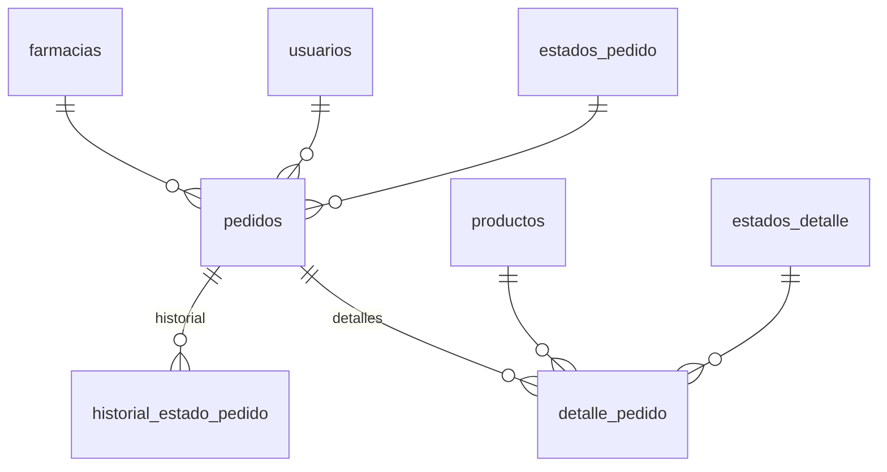

---

### Pedido

| Campo | Tipo | Descripción |
|-------|------|-------------|
| `id_pedido` | PK (bigIncrements) | Identificador único |
| `id_farmacia` | FK→`farmacias` | Farmacia destino (restrict) |
| `id_usuario` | FK→`usuarios` | Usuario que registró (restrict) |
| `id_estado_pedido` | FK→`estados_pedido` | Estado del pedido (restrict) |
| `fecha_pedido` | timestamp | Fecha del pedido (useCurrent) |
| `observaciones` | text | Observaciones (nullable) |
| `subtotal` | decimal(10,2) | Subtotal del pedido (default 0) |
| `descuento` | decimal(10,2) | Descuento aplicado (default 0) |
| `total` | decimal(10,2) | Total del pedido (default 0) |
| `archivo_pedido` | string(255) | Ruta del archivo PDF adjunto (nullable) |

**Tabla:** `pedidos` | **PK:** `id_pedido` | **Timestamps:** No | **Traits:** HasFactory

> `subtotal`, `descuento`, `total` agregados por migración `2024_06_11_000004`.
> `archivo_pedido` agregado por migración `2024_06_11_000013`.

**Casts:** `fecha_pedido:datetime`

**Relaciones:**
| Tipo | Método | Modelo destino | FK |
|------|--------|----------------|----|
| belongsTo | `farmacia()` | `Farmacia` | `id_farmacia` |
| belongsTo | `usuario()` | `Usuario` | `id_usuario` |
| belongsTo | `estado()` | `EstadoPedido` | `id_estado_pedido` |
| hasMany | `historiales()` | `HistorialEstadoPedido` | `id_pedido` |
| hasOne | `despacho()` | `Despacho` | `id_pedido` |
| hasMany | `detalles()` | `DetallePedido` | `id_pedido` |

---

### EstadoPedido

| Campo | Tipo | Descripción |
|-------|------|-------------|
| `id_estado_pedido` | PK (tinyIncrements) | Identificador único |
| `nombre_estado` | string(50) | Nombre del estado (**unique**) |

**Tabla:** `estados_pedido` | **PK:** `id_estado_pedido` | **Timestamps:** No

**Relaciones:**
| Tipo | Método | Modelo destino | FK |
|------|--------|----------------|----|
| hasMany | `pedidos()` | `Pedido` | `id_estado_pedido` |
| hasMany | `historiales()` | `HistorialEstadoPedido` | `id_estado_pedido` |

---

### HistorialEstadoPedido

| Campo | Tipo | Descripción |
|-------|------|-------------|
| `id_historial` | PK (bigIncrements) | Identificador único |
| `id_pedido` | FK→`pedidos` | Pedido asociado (cascade) |
| `id_estado_pedido` | FK→`estados_pedido` | Estado asignado (restrict) |
| `fecha_inicio` | timestamp | Fecha de inicio del estado (useCurrent) |
| `fecha_fin` | timestamp | Fecha de fin del estado (nullable) |

**Tabla:** `historial_estado_pedido` | **PK:** `id_historial` | **Timestamps:** No

**Casts:** `fecha_inicio:datetime`, `fecha_fin:datetime`

**Unique compuesto:** `(id_pedido, fecha_inicio)`

**Relaciones:**
| Tipo | Método | Modelo destino | FK |
|------|--------|----------------|----|
| belongsTo | `pedido()` | `Pedido` | `id_pedido` |
| belongsTo | `estado()` | `EstadoPedido` | `id_estado_pedido` |

---

### DetallePedido

| Campo | Tipo | Descripción |
|-------|------|-------------|
| `id_detalle` | PK (bigIncrements) | Identificador único |
| `id_pedido` | FK→`pedidos` | Pedido asociado (cascade) |
| `id_producto` | FK→`productos` | Producto asociado (restrict) |
| `cantidad_solicitada` | decimal(10,2) | Cantidad solicitada (default 0) |
| `cantidad_entregada` | decimal(10,2) | Cantidad entregada (default 0) |
| `precio_unitario` | decimal(10,2) | Precio unitario al momento del pedido (default 0) |
| `subtotal` | decimal(10,2) | Subtotal del detalle (default 0) |
| `id_estado_detalle` | FK→`estados_detalle` | Estado del detalle (default 1, restrict) |

**Tabla:** `detalle_pedido` | **PK:** `id_detalle` | **Timestamps:** No | **Traits:** HasFactory

**Relaciones:**
| Tipo | Método | Modelo destino | FK |
|------|--------|----------------|----|
| belongsTo | `pedido()` | `Pedido` | `id_pedido` |
| belongsTo | `producto()` | `Producto` | `id_producto` |
| belongsTo | `estado()` | `EstadoDetalle` | `id_estado_detalle` |

---

### Producto

| Campo | Tipo | Descripción |
|-------|------|-------------|
| `id_producto` | PK (bigIncrements) | Identificador único |
| `nombre` | string(200) | Nombre del producto |
| `precio_unitario` | decimal(10,2) | Precio unitario (default 0) |
| `unidad_medida` | string(20) | Unidad de medida (default 'UNIDAD') |
| `estado` | boolean | Estado del producto (default true) |

**Tabla:** `productos` | **PK:** `id_producto` | **Timestamps:** Sí (created_at, updated_at) | **Traits:** HasFactory

**Casts:** `precio_unitario:decimal:2`, `estado:boolean`

**Relaciones:**
| Tipo | Método | Modelo destino | FK |
|------|--------|----------------|----|
| hasMany | `detalles()` | `DetallePedido` | `id_producto` |

---

### EstadoDetalle

| Campo | Tipo | Descripción |
|-------|------|-------------|
| `id_estado_detalle` | PK (tinyIncrements) | Identificador único |
| `nombre_estado` | string(50) | Nombre del estado (**unique**) |

**Tabla:** `estados_detalle` | **PK:** `id_estado_detalle` | **Timestamps:** No

**Relaciones:**
| Tipo | Método | Modelo destino | FK |
|------|--------|----------------|----|
| hasMany | `detalles()` | `DetallePedido` | `id_estado_detalle` |

---

## 6. Despacho

### Diagrama ERD - Despacho

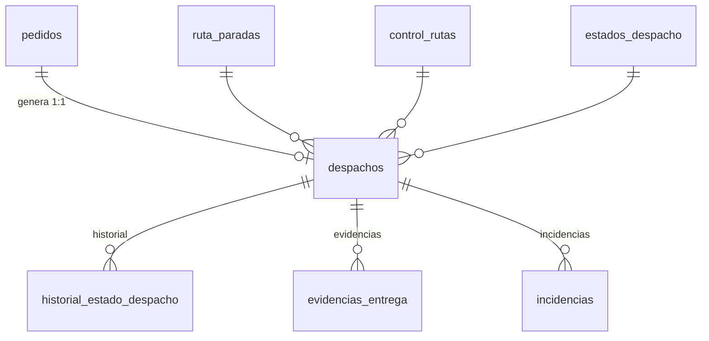

---

### Despacho

| Campo | Tipo | Descripción |
|-------|------|-------------|
| `id_despacho` | PK (bigIncrements) | Identificador único |
| `id_pedido` | FK→`pedidos` | Pedido asociado (**unique**, restrict) |
| `id_parada` | FK→`ruta_paradas` | Parada de ruta (restrict) |
| `id_control_ruta` | FK→`control_rutas` | Control de ruta (restrict) |
| `fecha_hora_despacho` | timestamp | Fecha y hora del despacho (useCurrent) |
| `id_estado_despacho` | FK→`estados_despacho` | Estado del despacho (restrict) |

**Tabla:** `despachos` | **PK:** `id_despacho` | **Timestamps:** No | **Traits:** HasFactory

> Unique en `id_pedido` agregado por migración `2024_06_11_000017`.

**Casts:** `fecha_hora_despacho:datetime`

**Relaciones:**
| Tipo | Método | Modelo destino | FK |
|------|--------|----------------|----|
| belongsTo | `pedido()` | `Pedido` | `id_pedido` |
| belongsTo | `parada()` | `RutaParada` | `id_parada` |
| belongsTo | `controlRuta()` | `ControlRuta` | `id_control_ruta` |
| belongsTo | `estado()` | `EstadoDespacho` | `id_estado_despacho` |
| hasMany | `historiales()` | `HistorialEstadoDespacho` | `id_despacho` |
| hasMany | `incidencias()` | `Incidencia` | `id_despacho` |
| hasMany | `evidencias()` | `EvidenciaEntrega` | `id_despacho` |

---

### EstadoDespacho

| Campo | Tipo | Descripción |
|-------|------|-------------|
| `id_estado_despacho` | PK (tinyIncrements) | Identificador único |
| `nombre_estado` | string(50) | Nombre del estado (**unique**) |

**Tabla:** `estados_despacho` | **PK:** `id_estado_despacho` | **Timestamps:** No

**Relaciones:**
| Tipo | Método | Modelo destino | FK |
|------|--------|----------------|----|
| hasMany | `despachos()` | `Despacho` | `id_estado_despacho` |
| hasMany | `historiales()` | `HistorialEstadoDespacho` | `id_estado_despacho` |

---

### HistorialEstadoDespacho

| Campo | Tipo | Descripción |
|-------|------|-------------|
| `id_historial` | PK (bigIncrements) | Identificador único |
| `id_despacho` | FK→`despachos` | Despacho asociado (cascade) |
| `id_estado_despacho` | FK→`estados_despacho` | Estado asignado (restrict) |
| `fecha_inicio` | timestamp | Fecha de inicio del estado (useCurrent) |
| `fecha_fin` | timestamp | Fecha de fin del estado (nullable) |

**Tabla:** `historial_estado_despacho` | **PK:** `id_historial` | **Timestamps:** No

**Casts:** `fecha_inicio:datetime`, `fecha_fin:datetime`

**Unique compuesto:** `(id_despacho, fecha_inicio)`

**Relaciones:**
| Tipo | Método | Modelo destino | FK |
|------|--------|----------------|----|
| belongsTo | `despacho()` | `Despacho` | `id_despacho` |
| belongsTo | `estado()` | `EstadoDespacho` | `id_estado_despacho` |

---

## 7. Logística

### Diagrama ERD - Logística

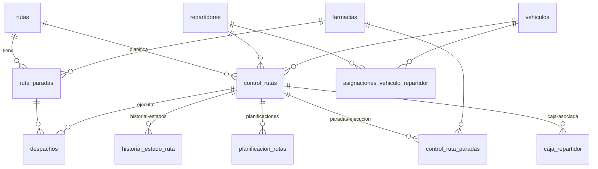

---

### Ruta

| Campo | Tipo | Descripción |
|-------|------|-------------|
| `id_ruta` | PK (smallIncrements) | Identificador único |
| `nombre_ruta` | string(100) | Nombre de la ruta (**unique**) |

**Tabla:** `rutas` | **PK:** `id_ruta` | **Timestamps:** No | **Traits:** HasFactory

**Relaciones:**
| Tipo | Método | Modelo destino | FK | Nota |
|------|--------|----------------|-----|------|
| hasMany | `paradas()` | `RutaParada` | `id_ruta` | Ordenado por `orden_parada ASC` |
| hasMany | `controles()` | `ControlRuta` | `id_ruta` | |

---

### RutaParada

| Campo | Tipo | Descripción |
|-------|------|-------------|
| `id_parada` | PK (bigIncrements) | Identificador único |
| `id_ruta` | FK→`rutas` | Ruta asociada (cascade) |
| `id_farmacia` | FK→`farmacias` | Farmacia de la parada (restrict) |
| `orden_parada` | smallInteger | Orden de la parada en la ruta (>= 1) |
| `hora_estimada` | time | Hora estimada de llegada (H:i:s) |

**Tabla:** `ruta_paradas` | **PK:** `id_parada` | **Timestamps:** No | **Traits:** HasFactory

**Unique compuesto:** `(id_ruta, orden_parada)`

**Relaciones:**
| Tipo | Método | Modelo destino | FK |
|------|--------|----------------|----|
| belongsTo | `ruta()` | `Ruta` | `id_ruta` |
| belongsTo | `farmacia()` | `Farmacia` | `id_farmacia` |
| hasMany | `despachos()` | `Despacho` | `id_parada` |

---

### ControlRuta

| Campo | Tipo | Descripción |
|-------|------|-------------|
| `id_control_ruta` | PK (bigIncrements) | Identificador único |
| `id_ruta` | FK→`rutas` | Ruta controlada (restrict) |
| `fecha_ruta` | date | Fecha de la ruta |
| `hora_salida` | time | Hora de salida (H:i:s) |
| `hora_llegada_real` | time | Hora de llegada real (nullable) |
| `id_repartidor` | FK→`repartidores` | Repartidor asignado (restrict) |
| `id_vehiculo` | FK→`vehiculos` | Vehículo asignado (restrict) |
| `id_estado_ruta` | FK→`estados_ruta` | Estado de la ruta (default 1) |

**Tabla:** `control_rutas` | **PK:** `id_control_ruta` | **Timestamps:** No | **Traits:** HasFactory

> `id_estado_ruta` agregado por migración `2024_06_11_000007`.

**Unique compuesto:** `(id_ruta, fecha_ruta)`

**Relaciones:**
| Tipo | Método | Modelo destino | FK |
|------|--------|----------------|----|
| belongsTo | `ruta()` | `Ruta` | `id_ruta` |
| belongsTo | `repartidor()` | `Repartidor` | `id_repartidor` |
| belongsTo | `vehiculo()` | `Vehiculo` | `id_vehiculo` |
| belongsTo | `estado()` | `EstadoRuta` | `id_estado_ruta` |
| hasMany | `despachos()` | `Despacho` | `id_control_ruta` |
| hasMany | `planificaciones()` | `PlanificacionRuta` | `id_control_ruta` |
| hasMany | `paradasEjecucion()` | `ControlRutaParada` | `id_control_ruta` |

---

### EstadoRuta

| Campo | Tipo | Descripción |
|-------|------|-------------|
| `id_estado_ruta` | PK (tinyIncrements) | Identificador único |
| `nombre_estado` | string(50) | Nombre del estado (**unique**) |

**Tabla:** `estados_ruta` | **PK:** `id_estado_ruta` | **Timestamps:** No

**Relaciones:**
| Tipo | Método | Modelo destino | FK |
|------|--------|----------------|----|
| hasMany | `controles()` | `ControlRuta` | `id_estado_ruta` |

---

### HistorialEstadoRuta

| Campo | Tipo | Descripción |
|-------|------|-------------|
| `id_historial` | PK (bigIncrements) | Identificador único |
| `id_control_ruta` | FK→`control_rutas` | Control de ruta asociado (cascade) |
| `id_estado_ruta` | FK→`estados_ruta` | Estado asignado (restrict) |
| `fecha_inicio` | datetime | Fecha de inicio del estado |
| `fecha_fin` | datetime | Fecha de fin del estado (nullable) |

**Tabla:** `historial_estado_ruta` | **PK:** `id_historial` | **Timestamps:** No

**Casts:** `fecha_inicio:datetime`, `fecha_fin:datetime`

**Relaciones:**
| Tipo | Método | Modelo destino | FK |
|------|--------|----------------|----|
| belongsTo | `controlRuta()` | `ControlRuta` | `id_control_ruta` |
| belongsTo | `estado()` | `EstadoRuta` | `id_estado_ruta` |

---

### PlanificacionRuta

| Campo | Tipo | Descripción |
|-------|------|-------------|
| `id_planificacion` | PK (bigIncrements) | Identificador único |
| `id_usuario` | FK→`usuarios` | Usuario que planificó (restrict) |
| `id_control_ruta` | FK→`control_rutas` | Control de ruta asociado (nullable, set null) |
| `estado` | string(20) | Estado de la planificación (default 'BORRADOR') |
| `datos_json` | json | Datos de la planificación (asignaciones) (nullable) |
| `fecha_creacion` | datetime | Fecha de creación (useCurrent) |
| `fecha_confirmacion` | datetime | Fecha de confirmación (nullable) |

**Tabla:** `planificacion_rutas` | **PK:** `id_planificacion` | **Timestamps:** No | **Traits:** HasFactory

**Casts:** `datos_json:array`, `fecha_creacion:datetime`, `fecha_confirmacion:datetime`

**Relaciones:**
| Tipo | Método | Modelo destino | FK |
|------|--------|----------------|----|
| belongsTo | `usuario()` | `Usuario` | `id_usuario` |
| belongsTo | `controlRuta()` | `ControlRuta` | `id_control_ruta` |

---

### ControlRutaParada

| Campo | Tipo | Descripción |
|-------|------|-------------|
| `id_control_ruta_parada` | PK (bigIncrements) | Identificador único |
| `id_control_ruta` | FK→`control_rutas` | Control de ruta asociado (cascade) |
| `id_pedido` | FK→`pedidos` | Pedido asociado (**nullable**, set null) |
| `id_farmacia` | FK→`farmacias` | Farmacia destino (restrict) |
| `orden_parada` | integer | Orden de la parada en la ejecución |
| `hora_estimada` | time | Hora estimada (nullable) |
| `hora_llegada_real` | time | Hora de llegada real (nullable) |

**Tabla:** `control_ruta_paradas` | **PK:** `id_control_ruta_parada` | **Timestamps:** Sí (created_at, updated_at) | **Traits:** HasFactory

**Unique compuesto:** `(id_control_ruta, orden_parada)`

**Relaciones:**
| Tipo | Método | Modelo destino | FK |
|------|--------|----------------|----|
| belongsTo | `controlRuta()` | `ControlRuta` | `id_control_ruta` |
| belongsTo | `pedido()` | `Pedido` | `id_pedido` |
| belongsTo | `farmacia()` | `Farmacia` | `id_farmacia` |

---

### AsignacionVehiculoRepartidor

| Campo | Tipo | Descripción |
|-------|------|-------------|
| `id_asignacion` | PK (bigIncrements) | Identificador único |
| `id_repartidor` | FK→`repartidores` | Repartidor asignado (restrict) |
| `id_vehiculo` | FK→`vehiculos` | Vehículo asignado (restrict) |
| `fecha_inicio` | datetime | Fecha de inicio de asignación (useCurrent) |
| `fecha_fin` | datetime | Fecha de fin (nullable) |
| `activo` | boolean | Si la asignación está activa (default true) |
| `observaciones` | string(255) | Observaciones (nullable) |

**Tabla:** `asignaciones_vehiculo_repartidor` | **PK:** `id_asignacion` | **Timestamps:** Sí (created_at, updated_at)

**Índices:** `asignaciones_repartidor_activo_index` (id_repartidor, activo), `asignaciones_vehiculo_activo_index` (id_vehiculo, activo)

**Relaciones:**
| Tipo | Método | Modelo destino | FK |
|------|--------|----------------|----|
| belongsTo | `repartidor()` | `Repartidor` | `id_repartidor` |
| belongsTo | `vehiculo()` | `Vehiculo` | `id_vehiculo` |

---

## 8. Evidencia

### Diagrama ERD - Evidencia

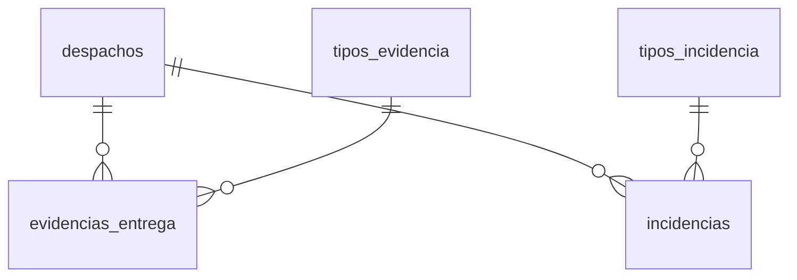

---

### EvidenciaEntrega

| Campo | Tipo | Descripción |
|-------|------|-------------|
| `id_evidencia` | PK (bigIncrements) | Identificador único |
| `id_despacho` | FK→`despachos` | Despacho asociado (cascade) |
| `id_tipo_evidencia` | FK→`tipos_evidencia` | Tipo de evidencia (restrict) |
| `archivo` | string(255) | Ruta del archivo de evidencia |
| `fecha_registro` | timestamp | Fecha de registro (useCurrent) |

**Tabla:** `evidencias_entrega` | **PK:** `id_evidencia` | **Timestamps:** No

**Casts:** `fecha_registro:datetime`

**Relaciones:**
| Tipo | Método | Modelo destino | FK |
|------|--------|----------------|----|
| belongsTo | `despacho()` | `Despacho` | `id_despacho` |
| belongsTo | `tipoEvidencia()` | `TipoEvidencia` | `id_tipo_evidencia` |

---

### Incidencia

| Campo | Tipo | Descripción |
|-------|------|-------------|
| `id_incidencia` | PK (bigIncrements) | Identificador único |
| `id_despacho` | FK→`despachos` | Despacho asociado (cascade) |
| `id_tipo_incidencia` | FK→`tipos_incidencia` | Tipo de incidencia (restrict) |
| `descripcion` | text | Descripción de la incidencia |
| `fecha_incidencia` | timestamp | Fecha de la incidencia (useCurrent) |

**Tabla:** `incidencias` | **PK:** `id_incidencia` | **Timestamps:** No

**Casts:** `fecha_incidencia:datetime`

**Relaciones:**
| Tipo | Método | Modelo destino | FK |
|------|--------|----------------|----|
| belongsTo | `despacho()` | `Despacho` | `id_despacho` |
| belongsTo | `tipoIncidencia()` | `TipoIncidencia` | `id_tipo_incidencia` |

---

### TipoEvidencia

| Campo | Tipo | Descripción |
|-------|------|-------------|
| `id_tipo_evidencia` | PK (tinyIncrements) | Identificador único |
| `nombre_tipo` | string(100) | Nombre del tipo de evidencia (**unique**) |

**Tabla:** `tipos_evidencia` | **PK:** `id_tipo_evidencia` | **Timestamps:** No

**Relaciones:**
| Tipo | Método | Modelo destino | FK |
|------|--------|----------------|----|
| hasMany | `evidencias()` | `EvidenciaEntrega` | `id_tipo_evidencia` |

---

### TipoIncidencia

| Campo | Tipo | Descripción |
|-------|------|-------------|
| `id_tipo_incidencia` | PK (tinyIncrements) | Identificador único |
| `nombre_tipo` | string(100) | Nombre del tipo de incidencia (**unique**) |

**Tabla:** `tipos_incidencia` | **PK:** `id_tipo_incidencia` | **Timestamps:** No

**Relaciones:**
| Tipo | Método | Modelo destino | FK |
|------|--------|----------------|----|
| hasMany | `incidencias()` | `Incidencia` | `id_tipo_incidencia` |

---

## 9. Caja

### Diagrama ERD - Caja

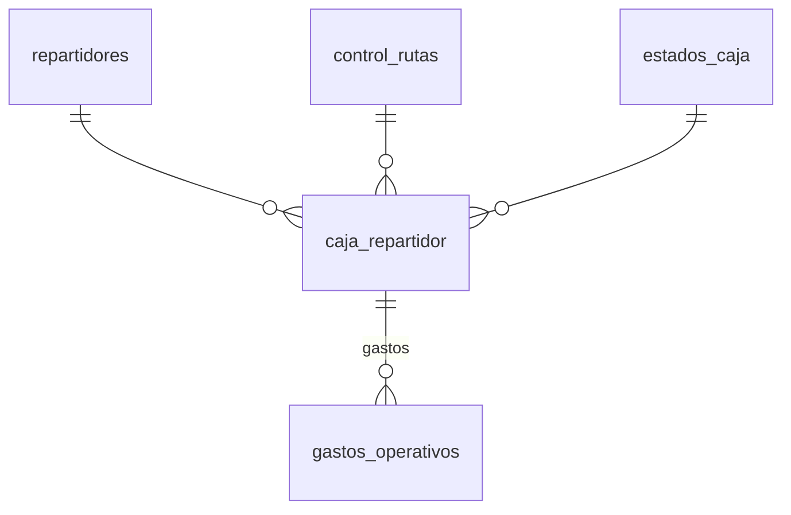

---

### CajaRepartidor

| Campo | Tipo | Descripción |
|-------|------|-------------|
| `id_caja` | PK (bigIncrements) | Identificador único |
| `id_control_ruta` | FK→`control_rutas` | Control de ruta asociado (**nullable**, **unique**, set null) |
| `id_repartidor` | FK→`repartidores` | Repartidor asociado (restrict) |
| `fecha` | date | Fecha de la caja |
| `monto_inicial` | decimal(10,2) | Monto inicial en caja (default 0) |
| `ingresos` | decimal(10,2) | Total de ingresos registrados (default 0) |
| `gastos` | decimal(10,2) | Total de gastos registrados (default 0) |
| `monto_final` | decimal(10,2) | Monto final calculado (default 0) |
| `id_estado_caja` | FK→`estados_caja` | Estado de la caja (default 1, restrict) |

**Tabla:** `caja_repartidor` | **PK:** `id_caja` | **Timestamps:** No | **Traits:** HasFactory

**Unique compuesto:** `(id_repartidor, fecha)`

**Relaciones:**
| Tipo | Método | Modelo destino | FK |
|------|--------|----------------|----|
| belongsTo | `repartidor()` | `Repartidor` | `id_repartidor` |
| belongsTo | `controlRuta()` | `ControlRuta` | `id_control_ruta` |
| belongsTo | `estado()` | `EstadoCaja` | `id_estado_caja` |
| hasMany | `gastos()` | `GastoOperativo` | `id_caja` |

---

### GastoOperativo

| Campo | Tipo | Descripción |
|-------|------|-------------|
| `id_gasto` | PK (bigIncrements) | Identificador único |
| `id_caja` | FK→`caja_repartidor` | Caja asociada (cascade) |
| `tipo_gasto` | string(50) | Tipo de gasto (combustible, peaje, etc.) |
| `descripcion` | string(255) | Descripción del gasto (nullable) |
| `monto` | decimal(10,2) | Monto del gasto |
| `comprobante` | string(255) | Ruta del comprobante (nullable) |
| `fecha` | datetime | Fecha del gasto (useCurrent) |

**Tabla:** `gastos_operativos` | **PK:** `id_gasto` | **Timestamps:** No | **Traits:** HasFactory

**Casts:** `monto:decimal:2`, `fecha:datetime`

**Relaciones:**
| Tipo | Método | Modelo destino | FK |
|------|--------|----------------|----|
| belongsTo | `caja()` | `CajaRepartidor` | `id_caja` |

---

### EstadoCaja

| Campo | Tipo | Descripción |
|-------|------|-------------|
| `id_estado_caja` | PK (tinyIncrements) | Identificador único |
| `nombre_estado` | string(50) | Nombre del estado (**unique**) |

**Tabla:** `estados_caja` | **PK:** `id_estado_caja` | **Timestamps:** No

**Relaciones:**
| Tipo | Método | Modelo destino | FK |
|------|--------|----------------|----|
| hasMany | `cajas()` | `CajaRepartidor` | `id_estado_caja` |

---

## 10. Modelos Huérfanos

Los siguientes modelos existen en el código pero **no son importados directamente por ningún controlador** — solo se acceden indirectamente vía relaciones de Eloquent o no se usan en absoluto:

| # | Modelo | Acceso | Estado |
|---|--------|--------|--------|
| 1 | `SesionUsuario` | Sin controlador que lo importe | **Completamente huérfano** |
| 2 | `Auditoria` | Sin controlador que lo importe | **Completamente huérfano** |
| 3 | `EstadoDetalle` | Solo vía `$detalle->estado()` en `DetallePedidoController` | Solo relación |
| 4 | `EstadoRuta` | Solo vía `$control->estado()` en `ControlRutaController` y `CentroLogisticoController` | Solo relación |
| 5 | `EstadoCaja` | Solo vía `$caja->estado()` en `CajaController` | Solo relación |
| 6 | `AsignacionVehiculoRepartidor` | Solo vía `$repartidor->asignacionVehiculoActiva()` en `CentroLogisticoController` | Solo relación |

Los modelos **`SesionUsuario`** y **`Auditoria`** son candidatos a limpieza: sus tablas existen en BD, sus migraciones están ejecutadas, pero ningún controlador del sistema las utiliza actualmente. Si se requiere auditoría de sesiones en el futuro, las estructuras están listas.

---

## 11. Leyenda

| Símbolo | Significado |
|---------|-------------|
| PK | Primary Key (clave primaria) |
| FK→`tabla` | Foreign Key que referencia a la tabla indicada |
| UK | Unique Key (restricción de unicidad) |
| (nullable) | Permite valores nulos |
| (useCurrent) | Valor por defecto: CURRENT_TIMESTAMP |
| **Traits** | Traits de Laravel usados por el modelo |
| **Hidden** | Atributos ocultos en respuestas JSON |
| **Casts** | Conversión automática de tipos al acceder al atributo |
| Timestamps: No | `$timestamps = false` (sin created_at / updated_at) |
| Timestamps: Sí | `$timestamps = true` (usa created_at / updated_at de Laravel) |
| `hasOne` | Relación 1:1 |
| `hasMany` | Relación 1:N |
| `belongsTo` | Relación N:1 (inversa) |
| `belongsToMany` | Relación N:M |
| `hasOneThrough` | Relación 1:1 a través de tabla intermedia |
| restrict | ON DELETE RESTRICT (no permite eliminar si hay hijos) |
| cascade | ON DELETE CASCADE (elimina hijos automáticamente) |
| set null | ON DELETE SET NULL (pone la FK en null al eliminar padre) |
| tinyIncrements / smallIncrements | Tipo de columna auto-incremental en BD |
| **Mermaid** | Diagramas ERD generados con sintaxis Mermaid.js |

---

## Tablas Laravel (no modeladas)

El sistema incluye 3 tablas de Laravel que no tienen modelo Eloquent propio:

| Tabla | Propósito |
|-------|-----------|
| `password_resets` | Reset de contraseñas (Laravel default) |
| `failed_jobs` | Cola de trabajos fallidos (Laravel default) |
| `personal_access_tokens` | Tokens de API (Sanctum) |

La tabla default `users` de Laravel fue **eliminada** (migración `2024_06_11_000001_drop_users_table.php`) en favor de la tabla personalizada `usuarios`.
